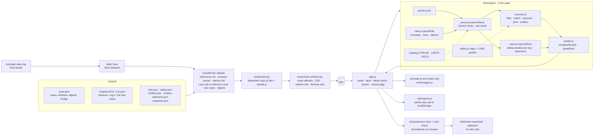

# Architecture

Static files, one trust boundary (the learner's browser tab), no server-side state. Everything below runs at build time in Node or at run time in the page; nothing runs anywhere else.

## Components

## Data flow at run time

1. `bundle.js` (generated) carries `CONTENT` (cases, chapters, lists, tables, casebook template), `DATASETS` by case id and `ENTITIES_BY_CASE` (each case's directory as flat `graph.*` records). The page imports it; there is no fetch.
2. The router reads the URL hash and renders a page through `ui/render.js`; every string becomes a text node.
3. On a mission, the desk's **Mode switch** chooses the parser. Search mode: `parseSearch` → `execute` → rows (events, entities or a statistics table). Rule mode: `parseRule` (envelope, `meta`, `options`) → `parseTokens(..., { rule: true })` (the body) → `executeRule` → detections, one per match key per sliding window that meets the condition.
4. **Check** grades by execution. A Search mission runs the learner's text and the reference against the same case data and compares the evidence (`compareResults`); a rule mission runs the learner's rule and checks the authored must-fire key and minute and the must-not-fire key (`gradeRuleCases`), reporting the false-positive count. Answers are read from the learner's own results; analyst calls are fixed-choice.
5. Points go to `ui/progress.js` (fixed values per part, opt-in storage, 16 KB bound). Casebook entries go to `ui/casebook.js` (per case, typed and bounded, opt-in storage, 96 KB bound); **Check my Casebook** runs the deterministic note check against the case's own record ids and the mission's anchors.
6. The case-closed page reads the case's brief mission for the three model columns, the learner's Determination and Handoff from the casebook, and the case's engineering bridge if it carries one.

## Build-time flow

`gen-data` → `validate-content` → unit tests → `build` → `check-artifact` → browser tests. The validator (`tools/lib.mjs`) is the gate: it runs every reference (Search or rule) against its case's data and directory, derives every authored answer, proves every Build starter fails and every hint 3 passes, checks every Log it (kind, prompt, anchors, record ids that exist and are returned by the reference), every rule mission's test cases, chapter density, each case's window, ranges, chapters, directory file and digest, and that each case asks for every Casebook entry kind and ends in a brief.

## Trust boundary

The only input is the learner's keystrokes (editor, answer box, radios, casebook forms), `localStorage` under two keys, and the URL hash. The parser bounds bytes, tokens, depth, atoms, outcomes, keys, list tests and rule windows; `safety.js` guards learner and content regex and truncates subjects; the executors run against bounded fictional arrays. Outputs that leave the tab happen only on click: a `blob:` Markdown download and a write-only clipboard copy. The CSP is `default-src 'none'; script-src 'self'; style-src 'self'; img-src 'self' data:; connect-src 'none'`; the artifact check refuses a build that loses it, references anything absolute or remote, or names a non-fictional domain or address. Content is trusted but validated at build time; stored state is untrusted and validated on load. The threat model is `docs/threat-models/THREAT_MODEL.md`.
